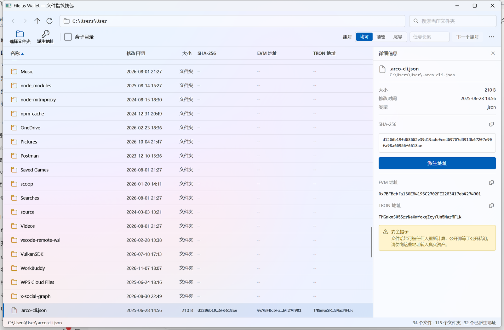
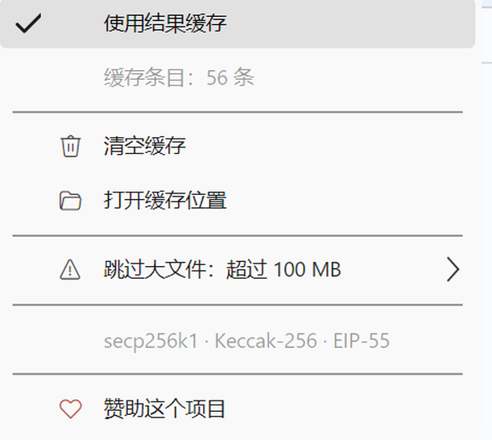

# File as Wallet — 文件指纹钱包

> 把任何一个文件当作一把钱包私钥：用文件内容的 SHA-256 指纹派生 EVM / TRON 区块链地址。



**File as Wallet** 是一个 Windows 桌面工具（Avalonia UI，WinUI 3 / Fluent 外观）。它像资源管理器一样浏览你的文件夹，对每个文件计算 SHA-256，并把哈希作为 secp256k1 私钥派生出对应的 EVM 与 TRON 地址——文件在，地址就在。

## ✨ 功能特性

- **资源管理器式浏览** — 目录导航（后退 / 前进 / 上一级 / 刷新）、地址栏、搜索、按名称 / 修改日期 / 大小排序；大目录流式加载，无文件数量上限，加载过程中即可操作。
- **一键派生地址** — 选中文件（或全目录）计算 SHA-256 并派生地址；列表内直接显示 SHA-256、EVM 地址、TRON 地址三列，点击文件在右侧详情面板查看完整信息与复制按钮。
- **靓号标记** — 默认规则：地址前缀或尾号出现 **4 位及以上连号** 即判定为靓号，整行荧光黄高亮；也可输入自定义匹配串（任意长度，可选只匹配前缀 / 只匹配尾号 / 前后缀均可），输入即时生效并重新匹配。「下一个靓号」按钮（F3）在命中的靓号之间循环跳转。
- **按排序顺序计算** — 派生任务严格按当前列表排序逐个进行，随时可以停止、随时可以继续下一个。
- **结果缓存** — 计算结果按「路径 + 大小 + 修改时间」缓存，文件没变就直接复用；可在右上角 ⋯ 菜单中开关、清空、打开缓存位置。
- **跳过大文件** — 可选跳过超过 10 / 50 / 100 / 500 MB 的文件，避免为了验证一个视频等上几分钟。
- **纯本地运行** — 不联网、不上传任何文件；所有计算在本机完成。



## 🔐 工作原理

```
文件字节流 ──SHA-256──▶ 32 字节摘要
    │
    ├─ 作为 secp256k1 私钥 ──ECDSA 公钥（非压缩，去 0x04 前缀）──▶ Keccak-256 取后 20 字节
    │        └─▶ EVM 地址（EIP-55 大小写校验格式，0x…）
    │
    └─ 0x41 前缀 + 20 字节 ──双 SHA-256 校验──▶ Base58Check
             └─▶ TRON 地址（T…）
```

- 私钥派生与地址编码：`Services/WalletService.cs`（BouncyCastle secp256k1 + Keccak-256）。
- 内置自检：`FileAsWallet --selftest` 跑 17 项断言（含与 ethers.js / tronweb 的已知向量对拍）。

## 📥 下载

前往 [Releases](https://github.com/lizzzhh/file-as-wallet/releases) 下载 `FileAsWallet-win-x64.zip`，解压后直接运行 `FileAsWallet.exe`（单文件、自包含运行时，无需安装 .NET）。

## 🚀 使用

1. 点击左上角「选择文件夹」（或直接把文件夹路径拖到地址栏），勾选「含子目录」可递归扫描；
2. 点击「派生地址」开始按排序顺序计算，按钮变为「停止生成」，再点一次即可随时停止；
3. 在「靓号」一栏选择前缀 / 尾号 / 均可，或直接输入自定义匹配串，命中的靓号会高亮，用「下一个靓号」循环跳转；
4. 右键任意文件可计算 / 复制哈希与地址、在资源管理器中显示；点击文件查看完整详情。

### 命令行参数

| 参数 | 说明 |
|---|---|
| `<路径>` | 启动时直接打开指定目录 |
| `--recursive` | 以「含子目录」模式启动 |
| `--vanity=8888` | 预置自定义靓号匹配串（兼容 `--prefix=` / `--suffix=`） |
| `--sponsor` | 直接打开赞助窗口 |
| `--demo` | 演示模式（生成示例文件列表，不读磁盘） |
| `--selftest` | 运行加密自检后退出 |

结果缓存与设置保存在 `%LOCALAPPDATA%\FileAsWallet\`（`result-cache.jsonl` / `settings.json`）。

## 🛠️ 从源码构建

```bash
# 需要 .NET 10 SDK
git clone https://github.com/lizzzhh/file-as-wallet.git
cd file-as-wallet
dotnet build -c Release
dotnet run --no-build -c Release            # 运行
dotnet run --no-build -c Release -- --selftest   # 加密自检

# 发布单文件可执行程序
dotnet publish -c Release -r win-x64 --self-contained true `
  -p:PublishSingleFile=true -p:IncludeNativeLibrariesForSelfExtract=true
```

技术栈：Avalonia 12（Fluent 主题）· .NET 10 · CommunityToolkit.Mvvm · BouncyCastle.Cryptography · QRCoder

## ⚠️ 安全提示（请务必阅读）

- **任何能读到这个文件的人都可以重新算出同一串地址**——文件即私钥。请不要用公开传播的文件（电影、安装包、别人发给你的文档）派生地址来存放真实资产。
- 建议挑一个**只属于你自己、不会外传**的文件；好奇心强的话，也可以专门找一个内容独特的小文件，看看能不能撞出带连号的靓号地址。
- 本项目生成的地址仅供学习与研究密钥派生流程使用，默认不应存放任何有真实价值的资产。

## ❤️ 赞助

如果这个工具对你有用，欢迎请作者喝杯咖啡：

**EVM（Ethereum / BSC / Polygon 等）**

```
0x8043457D5887a29c864F5628fE5b61dF0d000721
```

<p align="center"></p>

也可以直接在应用内右上角 ⋯ 菜单 → 「赞助这个项目」打开二维码窗口。

---

*File as Wallet · 保留所有权利 · 仅供学习研究使用*
